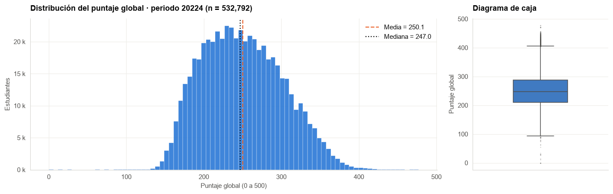
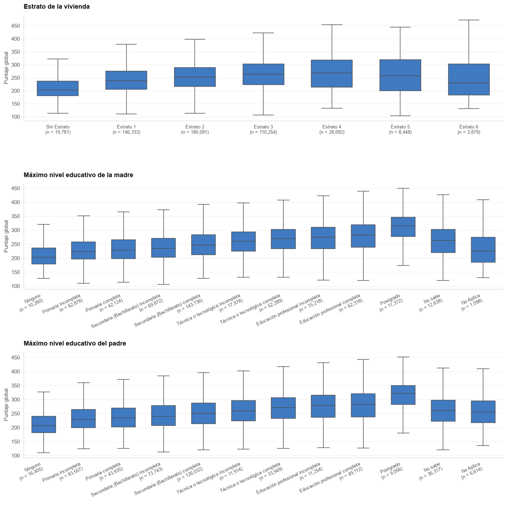
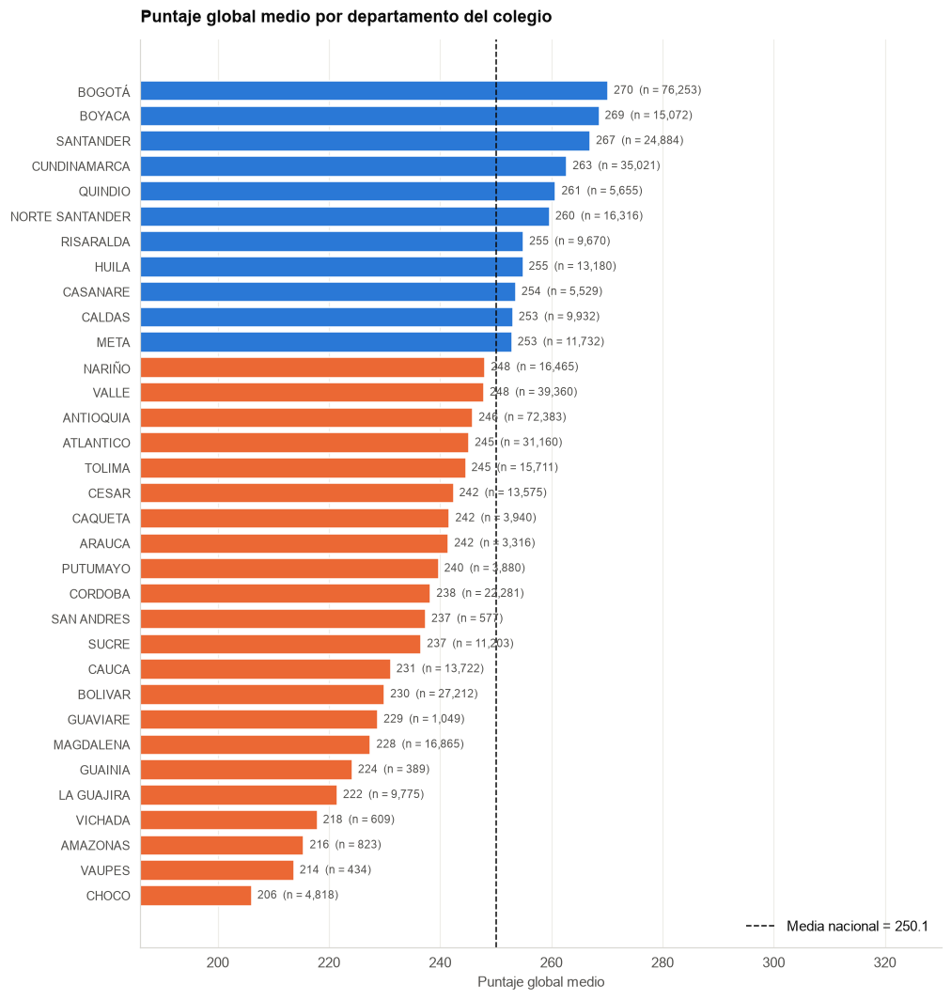

<div align="center">
    
</div>

# Predicción del puntaje global de la prueba Saber 11 a partir de variables socioeconómicas y del colegio

## 📋 Información General

<div align="center">
    
</div>

| Aspecto | Detalles |
|--------|----------|
| **Autor** | Andrés Giovanny Rubiano Muñoz "Andy Rubiano" |
| **Correo** | arubiano67@unisalle.edu.co |
| **Asignatura** | Ciencia de Datos |
| **Actividad** | Proyecto Integrador de Ciencia de Datos · Fases 1 a 4 (cuatro entregables) |
| **Programa** | Maestría en Inteligencia Artificial |
| **Universidad** | Universidad de La Salle |
| **Líneas de Trabajo** | Análisis Exploratorio de Datos, Aprendizaje Supervisado (Regresión) e Interpretabilidad |
| **Año** | 2026 |
| **Estado** | En desarrollo · Entregable 1 completado |

---

## 🎯 Descripción del Proyecto

La prueba Saber 11 es el examen de Estado que presentan en Colombia los estudiantes que terminan la educación media. Su puntaje global, en una escala de 0 a 500, decide en buena medida el acceso a la educación superior, a becas y a los cupos de las universidades públicas. El ICFES publica, por cada aplicación, un registro anónimo por estudiante con el resultado de la prueba y un cuestionario sociodemográfico sobre su hogar y su colegio.

Este proyecto recorre el ciclo completo de un problema de ciencia de datos sobre esos registros, desde la formulación hasta la comunicación de resultados, formulado como una tarea de **aprendizaje supervisado de regresión**:

> ¿En qué medida las características socioeconómicas del hogar, las características del colegio y las características demográficas del estudiante permiten predecir el puntaje global de la prueba Saber 11, y cuáles de esas características tienen mayor peso?

El trabajo se organiza en cuatro fases, cada una con su entregable:

- **Fase 1 · Problema y exploración de datos** — planteamiento del problema, descripción del conjunto de datos y análisis exploratorio (EDA). ✅
- **Fase 2 · Preparación y modelo base** — limpieza, ingeniería de variables, partición de datos y modelo de referencia.
- **Fase 3 · Modelado avanzado y evaluación** — modelos comparados, ajuste de hiperparámetros, métricas e interpretabilidad.
- **Fase 4 · Comunicación y entrega final** — visualizaciones, informe técnico final y sustentación.

Una restricción metodológica atraviesa todo el proyecto: el puntaje global es un **promedio ponderado de los puntajes por área**, de modo que esos puntajes no pueden usarse como variables explicativas sin incurrir en una fuga de información (*data leakage*). La fase 1 lo verifica sobre los datos.

### Objetivos Principales

- Describir el conjunto de datos *Resultados únicos Saber 11* (origen, licencia, variables, tamaño y calidad) y caracterizar la distribución de la variable objetivo.
- Identificar, mediante análisis exploratorio, las variables con mayor asociación con el puntaje global y las que deben excluirse por fuga de información o por falta de valor predictivo.
- Preparar los datos y establecer un modelo de referencia (*baseline*) con su métrica inicial.
- Entrenar y comparar al menos dos modelos adicionales al de referencia, ajustar sus hiperparámetros con validación cruzada y evaluarlos con métricas apropiadas para regresión (MAE, RMSE y R²).
- Interpretar el modelo final (importancia de variables, análisis de errores) y comunicar los resultados mediante visualizaciones, un informe técnico y una sustentación.

---

## 📚 Estructura del Repositorio

```
.
├── README.md                         # Este archivo
├── requirements.txt                  # Dependencias de Python para ejecución local
├── .gitignore                        # Excluye data/raw (560 MB) y artefactos de LaTeX
├── assets/
│   └── images/
│       ├── Logo.png                  # Logo institucional
│       ├── author/                   # Fotografía del autor
│       └── data/                     # Figuras generadas por el cuaderno (citadas desde los informes)
│           ├── missing_values.png             # Porcentaje de faltantes por columna
│           ├── target_distribution.png        # Histograma y caja del puntaje global
│           ├── student_variables.png          # Puntaje por género, edad y tipo de documento
│           ├── family_ordinal.png             # Puntaje por estrato y educación de los padres
│           ├── family_binary.png              # Bienes del hogar, personas y cuartos
│           ├── school_variables.png           # Naturaleza, área, calendario, jornada, carácter...
│           ├── geography.png                  # Puntaje medio por departamento
│           └── correlation_matrix.png         # Matriz de correlación de Spearman
├── data/
│   ├── raw/                          # CSV descargado desde datos.gov.co (ignorado por git)
│   └── processed/                    # Conjuntos depurados de la fase 2 (ignorado por git)
├── notebooks/
│   └── 01_planteamiento_y_eda.ipynb  # Entregable 1: planteamiento, descripción del dataset y EDA
├── reports/
│   └── entregable1/                  # Informe IEEE del Entregable 1
│       ├── main.tex                  # Documento principal (preámbulo + \input de secciones)
│       ├── main.pdf                  # Informe compilado (17 páginas)
│       ├── IEEEtran.cls              # Clase LaTeX del formato IEEE conference
│       └── src/
│           ├── sections/             # abstract, introduction, problem, dataset, methodology, results, conclusions
│           └── appendices/           # Apéndice A: cuaderno de Google Colab
└── utils/
    ├── codes/                        # Un archivo .py por cada celda de código del cuaderno (citados vía \lstinputlisting)
    │   ├── environment-setup/                 # Importaciones y resolución de rutas del proyecto
    │   ├── graphic-identity/                  # Paleta, estilo de figuras, semilla y save_fig
    │   ├── dataset-download/                  # Descarga del periodo 2022-4 por la API de Socrata y lectura tipada
    │   ├── dataset-structure/                 # Tipo, nulos, cardinalidad y ejemplo por columna
    │   ├── data-quality/                      # Duplicados, columnas constantes y cardinalidad
    │   ├── missing-values/                    # Faltantes por columna y análisis del cuestionario
    │   ├── type-conversion/                   # Edad al presentar la prueba y orden de las ordinales
    │   ├── target-distribution/               # Descriptivos, histograma y caja de punt_global
    │   ├── target-formula/                    # Verificación de la fórmula del puntaje global
    │   ├── student-variables/                 # Género, edad y tipo de documento
    │   ├── family-variables/                  # Estrato y educación de los padres
    │   ├── family-binary/                     # Bienes del hogar, personas y cuartos
    │   ├── school-variables/                  # Variables del colegio
    │   ├── school-crosstab/                   # Cruce naturaleza × área
    │   ├── geography/                         # Puntaje medio por departamento
    │   ├── correlations/                      # Codificación ordinal y matriz de Spearman
    │   └── exploratory-fit/                   # Regresión lineal exploratoria
    └── references/
        └── references.bib            # Bibliografía IEEE (14 referencias)
```

---

## 🧪 Metodología

El desarrollo de cada fase se realiza en un **cuaderno de Google Colab**, numerado dentro de `notebooks/`. Cada celda de código tiene su archivo espejo en [`utils/codes/`](utils/codes/) y se cita en el informe mediante `\lstinputlisting`, de modo que documento y cuaderno se mantienen sincronizados uno a uno.

### Fase 1 · Conjunto de datos

Se utiliza el conjunto **Resultados únicos Saber 11**, publicado por el ICFES en el Portal Nacional de Datos Abiertos ([datos.gov.co/d/kgxf-xxbe](https://www.datos.gov.co/Educaci-n/Resultados-nicos-Saber-11/kgxf-xxbe)) bajo licencia **CC BY-SA 4.0**. Reúne 7,1 millones de registros de las aplicaciones entre 2010 y 2022 con 51 columnas. Se trabaja con el periodo **2022-4** (calendario A del segundo semestre de 2022), descargado con un filtro en la API de Socrata.

| Aspecto | Valor |
|---|---|
| Archivo | `data/raw/saber11_20224.csv` (560 MB, 1.065.888 filas descargadas) |
| Filas únicas | **532.792** estudiantes (la mitad de las filas del portal son duplicados exactos) |
| Columnas | 51: identificación (5), colegio `cole_*` (17), estudiante `estu_*` (13), hogar `fami_*` (9), resultados (7) |
| Variable objetivo | `punt_global` — puntaje global de la prueba (0 a 500) |
| Excluidas por fuga de información | `punt_lectura_critica`, `punt_matematicas`, `punt_sociales_ciudadanas`, `punt_c_naturales`, `punt_ingles`, `desemp_ingles` |

### Fase 1 · Calidad de los datos

| Diagnóstico | Hallazgo | Tratamiento |
|---|---|---|
| Duplicados | 533.096 filas (50,01 %) son duplicados exactos; `estu_consecutivo` tiene 532.792 valores distintos | Se eliminan antes de cualquier análisis o partición |
| Columnas constantes | `periodo`, `estu_estudiante` | Se descartan |
| Columnas casi constantes | `cole_calendario` (99,58 % A), `estu_estadoinvestigacion` (99,96 %), `estu_privado_libertad` (99,95 %) | Sin valor predictivo |
| Valores faltantes | `cole_bilingue` 18,0 %; bloque `fami_*` entre 4,3 % y 6,7 %; 2,31 % de estudiantes sin cuestionario | La ausencia es informativa (229,1 vs. 250,6 puntos): se conserva como categoría |
| Fecha de nacimiento | Texto `dd/mm/aaaa`; 81 fechas no interpretables, 218 edades fuera de [13, 80] | Edad al 4 de septiembre de 2022; fuera de rango → `NaN` |
| Fórmula del puntaje global | `round((3·LC + 3·MAT + 3·SOC + 3·CN + 1·ING) / 13 × 5)` se cumple en el 100 % de los registros | Los puntajes por área se excluyen como variables explicativas |

### Fase 1 · Análisis exploratorio

Para cada grupo de variables (estudiante, hogar, colegio, geografía) se calcula tamaño, media, mediana y desviación del puntaje por categoría y se grafica con diagramas de caja sin valores atípicos. Las variables ordinales se codifican con enteros que respetan su orden y se calcula la **correlación de Spearman**; una **regresión lineal exploratoria** (200.000 filas, partición 80/20, semilla 42) da una cota de la varianza explicable de forma aditiva.

### Fases 2 a 4 (pendientes)

| Fase | Actividades | Entrega |
|---|---|---|
| 2 · Preparación y modelo base | Limpieza, codificación, variables derivadas, partición entrenamiento/validación/prueba y regresión lineal regularizada como *baseline* | 15 nov. 2026 |
| 3 · Modelado avanzado y evaluación | Al menos dos modelos adicionales (p. ej. *Random Forest* y *Gradient Boosting*), validación cruzada, MAE/RMSE/R², importancia de variables y análisis de errores | 22 nov. 2026 |
| 4 · Comunicación y entrega final | Visualizaciones, informe técnico final, sustentación y repositorio reproducible | 28 nov. 2026 |

---

## 📊 Resultados

### Entregable 1 · Variable objetivo

| Estadístico | Valor |
|---|---|
| Media / mediana | 250,1 / 247 |
| Desviación | 51,8 |
| Rango intercuartílico | 210 a 288 |
| Percentiles 1 y 99 | 156 y 369 |
| Asimetría / curtosis | 0,28 / −0,54 |

<div align="center">
    
</div>

<p align="center"><em>Distribución casi simétrica con una leve cola derecha: no requiere transformación y las métricas de error se leen directamente en puntos.</em></p>

### Entregable 1 · Asociaciones con el puntaje global

| Variable | Evidencia |
|---|---|
| Educación de la madre | De 211,2 puntos (*Ninguno*) a **307,5** (*Posgrado*): 96 puntos, el contraste más amplio del análisis. ρ = 0,35 |
| Edad | 265 puntos a los 16-17 años; 199,6 de 26 en adelante. ρ = −0,32 |
| Educación del padre | De 214,5 a 311,9 puntos. ρ = 0,32 |
| Internet y computador en el hogar | +31,8 y +31,7 puntos frente a no tenerlos. ρ = 0,28 y 0,30 |
| Jornada del colegio | Completa 280,8 vs. nocturna 210,6: **70 puntos** |
| Naturaleza del colegio | No oficial 272,6 vs. oficial 243,6: 29 puntos; interacción con el área (privado rural 291,1 > oficial rural 224,5) |
| Departamento del colegio | Bogotá 270,2 vs. Chocó 206,1: **64 puntos**; solo 11 de 33 departamentos superan la media nacional |
| Estrato | Monótono hasta el estrato 4 (267,4) y **cae** en el 5 (261,4) y el 6 (245,1): variable poco confiable |

<div align="center">
    
</div>

<p align="center"><em>La gradiente socioeconómica es perfectamente monótona en la educación de los padres y se quiebra en los estratos altos.</em></p>

<div align="center">
    
</div>

<p align="center"><em>El centro andino por encima de la media nacional; la periferia pacífica, amazónica y caribe por debajo.</em></p>

### Entregable 1 · Cota lineal exploratoria

| Modelo | R² (prueba) | MAE (puntos) |
|---|---|---|
| Predecir la media | 0,000 | 42,6 |
| Regresión lineal sobre variables codificadas | **0,242** | **36,5** |

Ninguna variable aislada correlaciona más de 0,35 con el puntaje, frente a 0,91 a 0,92 de los puntajes por área que se excluyen. El R² de 0,242 es el punto de partida honesto del proyecto: el modelo de referencia de la fase 2 deberá reproducirlo con la partición definitiva y los modelos de la fase 3 deberán superarlo.

> ⚠️ **Dos verificaciones de calidad evitaron métricas ficticias.** Sin la deduplicación, el mismo estudiante habría caído en entrenamiento y prueba; sin verificar la fórmula del puntaje global, un modelo con los puntajes por área habría alcanzado un error casi nulo sin aprender nada.

### Decisiones para la fase 2

Eliminar duplicados antes de particionar · excluir los puntajes por área · conservar los faltantes como categoría *no respondió* con indicador de cuestionario incompleto · descartar constantes, identificadores, nombres y columnas de residencia/presentación · educación de los padres como ordinal 0 a 9 · estrato como nominal o agrupado · crear *personas por cuarto* e *indicador de extraedad* · interacción naturaleza × área · departamento con *one-hot* o codificación por objetivo suavizada · regresión lineal regularizada como *baseline*.

---

## ⚙️ Requisitos

### Para ejecutar el cuaderno

> ℹ️ **No requiere instalación en Google Colab.** El conjunto de datos se descarga desde datos.gov.co mediante la API de Socrata (560 MB, entre tres y cinco minutos) y todas las dependencias vienen preinstaladas. La ejecución completa toma menos de diez minutos, la mayor parte en la descarga.

Para ejecutarlo localmente desde la raíz del repositorio:

```bash
pip install -r requirements.txt
```

```bash
jupyter nbconvert --to notebook --execute --inplace notebooks/01_planteamiento_y_eda.ipynb
```

El cuaderno detecta la raíz del repositorio, guarda el CSV en `data/raw/` (y lo reutiliza si ya existe) y escribe las figuras en `assets/images/data/`.

| Etapa | Dependencias |
|---|---|
| Carga y agregación | `pandas`, `numpy` |
| Visualización | `matplotlib`, `seaborn` |
| Correlaciones | `scipy` |
| Ajuste exploratorio | `scikit-learn` |

### Para compilar el informe LaTeX

- **Distribución LaTeX:** TeX Live, MiKTeX o MacTeX (LaTeX 2024+)
- **Compilador:** `pdflatex` o `latexmk` (recomendado)
- **Editor recomendado:** VS Code (con extensión LaTeX Workshop), TeXstudio u Overleaf

---

## 🛠️ Compilación del Documento

Cada informe se compila **dentro de su propia carpeta** en `reports/`; las figuras y los segmentos de código se referencian desde la raíz del repositorio mediante `\graphicspath{{../../}}` y la macro `\repo`.

```bash
cd reports/entregable1 && latexmk -pdf main.tex
```

Para limpiar los artefactos temporales:

```bash
cd reports/entregable1 && latexmk -c
```

> ⚠️ **No compilar con `-outdir` ni con `-output-directory`.** BibTeX se ejecuta con el directorio de trabajo en la carpeta de salida y desde allí la ruta relativa a `utils/references/references.bib` no existe.

---

## 🎨 Configuración del Documento

### Listings con resaltado para Python

El preámbulo de [`main.tex`](reports/entregable1/main.tex) configura `\lstset` con la paleta del documento, numeración de líneas y `breaklines=true`. El bloque `literate` cubre tildes, `ñ`, `ü`, `°`, `²` y los símbolos `≤`, `≥`, `→`, `·` y `−` que aparecen en los segmentos de código UTF-8; cualquier carácter nuevo fuera de ASCII en `utils/codes/` debe añadirse allí o `pdflatex` falla con `Invalid UTF-8 byte sequence`.

### Figuras a doble columna

Las figuras anchas usan el entorno `strip` del paquete `cuted`, que las inserta en su posición literal sin flotar. Como `strip` no puede partirse entre páginas, las tres figuras más altas (`family_ordinal`, `school_variables` y `correlation_matrix`) van precedidas de `\clearpage`; sin él la imagen se corta contra el borde inferior **sin que LaTeX emita ningún error**. Tras cualquier edición grande de texto conviene renderizar las páginas y mirarlas:

```bash
cd reports/entregable1 && pdftoppm -png -r 60 main.pdf pg
```

### Etiquetas en español y marca de agua

Como `babel` reasigna `\tablename` a *Cuadro* al iniciar el documento, la etiqueta *Tabla* se inyecta dentro de `\captionsspanish`. La marca de agua institucional se dibuja en la capa de fondo de todas las páginas y se controla con el flag `\showwatermarktrue` de `main.tex`.

### Convención de etiquetas (`\label`)

Nombres descriptivos en `snake_case`, sin prefijo de tipo: tablas `dataset_summary`, `variables`, `family_table`, `school_table`, `crosstab`, `spearman_table`, `decisions`; figuras `missing_values`, `target_distribution`, `student_variables`, `family_ordinal`, `family_binary`, `school_variables`, `geography`, `correlation_matrix`; ecuaciones `global_formula`, `spearman`.

---

## 📋 Estado del Proyecto

### ✅ Entregable 1 · Problema y exploración de datos (1 nov. 2026)

- ✅ **Planteamiento del problema** — contexto, pregunta de investigación, objetivo general y cinco específicos, tres hipótesis, alcance y restricciones
- ✅ **Descripción del conjunto de datos** — origen, licencia, periodo, tamaño y diccionario de las 51 variables en cinco bloques
- ✅ **Calidad de los datos** — deduplicación, columnas constantes, cardinalidad, valores faltantes y conversión de tipos
- ✅ **Análisis exploratorio** — variable objetivo, verificación de la fórmula del puntaje global, estudiante, hogar, colegio, geografía, correlaciones y ajuste lineal exploratorio
- ✅ **Hallazgos y decisiones** — doce decisiones de preparación e ingeniería de variables para la fase 2
- ✅ **Cuaderno** `01_planteamiento_y_eda.ipynb` con 17 celdas de código y 35 de narrativa, ejecutado de principio a fin
- ✅ **Informe IEEE** de 17 páginas, con 8 figuras, 7 tablas, 2 ecuaciones y 14 referencias, compilado sin referencias sin resolver
- ✅ 17 archivos Python en `utils/codes/`, uno por celda, todos citados desde el informe

### ⏳ Pendiente

- ⏳ **Entregable 2** — limpieza, ingeniería de variables, partición y modelo base (15 nov. 2026)
- ⏳ **Entregable 3** — modelos comparados, hiperparámetros, métricas e interpretabilidad (22 nov. 2026)
- ⏳ **Entregable 4** — visualizaciones, informe técnico final y sustentación (28 nov. 2026)
- ⏳ Publicar el cuaderno en Google Colab y actualizar el enlace del Apéndice A

---

## 📖 Guía de Estilo

| Aspecto | Valor |
|---|---|
| Idioma | Español |
| Formato | IEEE conference (`IEEEtran`, dos columnas) |
| Tamaño de página | Carta (8.5" × 11") |
| Fuente base | 10 pt |
| Bibliografía | IEEE |
| Extensión del Entregable 1 | 17 páginas |

---

## 🔑 Palabras Clave

`Ciencia de Datos` · `Análisis Exploratorio de Datos` · `Saber 11` · `ICFES` · `Regresión` · `Datos Abiertos` · `Fuga de Información` · `Nivel Socioeconómico` · `pandas` · `seaborn` · `scikit-learn`

---

## 🔗 Recursos

- [Dataset — Resultados únicos Saber 11 (datos.gov.co)](https://www.datos.gov.co/Educaci-n/Resultados-nicos-Saber-11/kgxf-xxbe)
- [API de Socrata del conjunto (CSV)](https://www.datos.gov.co/resource/kgxf-xxbe.csv)
- [ICFES — Prueba Saber 11](https://www.icfes.gov.co/evaluaciones-icfes/saber-11/)
- [DataIcfes — repositorio de bases de datos del ICFES](https://www.icfes.gov.co/data-icfes/)
- [pandas — User Guide](https://pandas.pydata.org/docs/user_guide/index.html)
- [seaborn — API reference](https://seaborn.pydata.org/api.html)
- [scikit-learn — Linear models](https://scikit-learn.org/stable/modules/linear_model.html)
- [Documentación LaTeX](https://www.latex-project.org/)

---

## 📧 Contacto

**Andrés Giovanny Rubiano Muñoz**
Maestría en Inteligencia Artificial · Universidad de La Salle
arubiano67@unisalle.edu.co

---

## 📄 Derechos Reservados

© 2026 Andrés Giovanny Rubiano Muñoz (Andy Rubiano). Todos los derechos reservados.

Este trabajo académico y su contenido —investigación, código, metodologías y documentación— son propiedad intelectual conjunta de:

- **Andrés Giovanny Rubiano Muñoz** (Andy Rubiano) — Autor
- **Universidad de La Salle** — Institución académica

Los datos utilizados pertenecen al ICFES y se distribuyen bajo licencia CC BY-SA 4.0 a través del Portal Nacional de Datos Abiertos de Colombia. El uso, reproducción o distribución del resto del trabajo requiere autorización previa escrita de los titulares de derechos.

---

<div align="center">
  Universidad de La Salle | Bogotá D. C., Colombia
</div>
